# NamiO — cliente de correo multiplataforma

NamiO es un cliente de correo de escritorio multiplataforma (IMAP/SMTP), con caché local.
El proyecto está orientado a Linux, Windows y macOS. Estado actual: **M8 en curso** — cuenta (contraseña u OAuth2), HTML, caché
offline, envío con cola, búsqueda local, sync completa, bienvenida guiada, reglas locales y **varias
cuentas conmutables** (una activa a la vez, sin bandeja unificada). Los instalables se generan en CI.

## Stack y por qué

| Pieza | Elección | Motivo |
| --- | --- | --- |
| Shell | Electron 45 | Chromium ya renderiza HTML de correo como lo espera el usuario; es el punto donde más se sufre en GTK/WebKit |
| UI | React 19 + TypeScript | Iteración rápida; sin framework de estilos para arrancar liviano |
| Build | electron-vite 6 + Vite 8 | HMR en el renderer y bundle CJS para main/preload |
| Paquetes | electron-builder 26 | AppImage + `.deb` desde CI en Ubuntu |

Costo asumido: ~150–300 MB de RAM. Si el objetivo pasa a ser un cliente ultraliviano, la ruta de
salida es Tauri + Rust, no seguir optimizando Electron.

## Arquitectura

```
┌── Renderer (React) ── solo UI, sin red, sin disco, sin Node ─┐
│                  IPC tipado (contextBridge)                  │
├── Main (Node) ── ventanas, menús, keyring, CSP ──────────────┤
│   Sync por sondeo cada 60 s (imapflow, sin IDLE)             │
│   SQLite WAL + FTS5 ← caché local = offline                  │
│   Cola de salida (nodemailer) + borradores                   │
└──────────────────────────────────────────────────────────────┘
```

**Regla dura:** la UI nunca toca la red. Todo pasa por la caché local, y los canales de
`src/shared/ipc.ts` son la única superficie pública del núcleo. Agregar un canal es una decisión de
seguridad.

```
src/
  main/      proceso principal: ventana, sesión, handlers IPC
  preload/   puente contextBridge; única API que ve la UI
  renderer/  React; cero privilegios
  shared/    contrato IPC y tipos compartidos
```

Decisiones de seguridad ya aplicadas en M0:

- `contextIsolation: true`, `sandbox: true`, `nodeIntegration: false`.
- Navegación externa bloqueada: los links van al navegador del sistema, nunca a una ventana de Electron.
- CSP estricta en producción (`script-src 'self'`, `object-src 'none'`, `connect-src 'self'`), con
  `frame-src 'self' about:` únicamente para el iframe del correo HTML.
- Permisos de la sesión denegados por defecto; se habilitan uno por uno cuando una feature lo justifique.
- Instancia única: dos procesos escribiendo la misma caché SQLite es un bug garantizado.

## Identidad visual

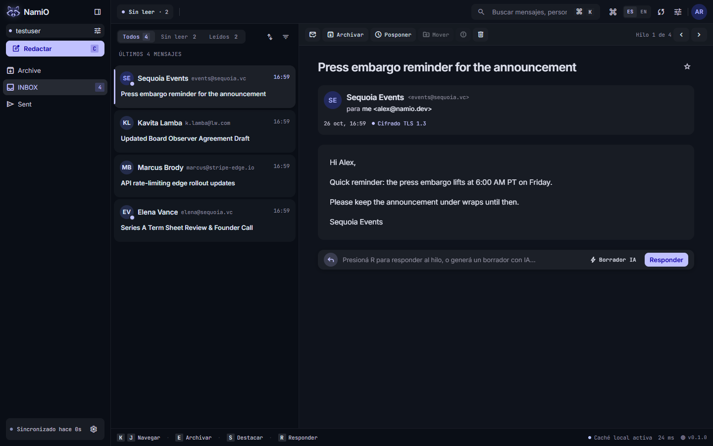

La interfaz sigue la identidad de los mockups **Veloce** —superficie casi negra con acentos
índigo-lavanda, Inter para el contenido y JetBrains Mono para metadatos, etiquetas y atajos— con la
marca **NamiO**. Los tokens viven en
[`src/renderer/src/styles/tokens.css`](src/renderer/src/styles/tokens.css): cambiar la marca es
cambiar ese archivo.

El sistema completo (paleta con contrastes medidos, escala tipográfica, layout, componentes, motion,
accesibilidad y reglas de implementación) está en **[DESIGN.md](DESIGN.md)**.

| Pieza | Decisión |
| --- | --- |
| Marca | Mapache índigo (logo) en el rail a 30 px; icono de app 512/1024 desde el mismo master |
| Paleta | `#0f131c` superficie · `#c0c1ff` primario · `#bdc2ff` secundario · `#b8c4ff` terciario · `#ffb4ab` error |
| Tipografía | Inter Variable (contenido) + JetBrains Mono Variable (metadatos, `kbd`, direcciones) |
| Iconos | Material Symbols Outlined, **empaquetado**: 4 MB de woff2, cero pedidos a CDN |
| Estructura | rail 224 · cola 380 · lectura flexible · contexto 320 · pie 36 |
| Atajos | `J`/`K` navegar · `E` archivar · `S` destacar · `R` responder · `C` redactar · `⌘K` paleta |

La UI se adapta al ancho: debajo de 1560px la ficha del remitente pasa a dos filas, debajo de 1520px
los atajos salen del toolbar de lectura (siguen en el pie) y debajo de 1280px se oculta el panel de
contexto.

El panel de contexto (IA) se colapsa con el botón del extremo derecho del toolbar: la lectura gana
todo el ancho y la preferencia se recuerda en `settings.json`. El colapso anima el ancho (260 ms) con
el contenido a ancho fijo, así se recorta en vez de reflowear.

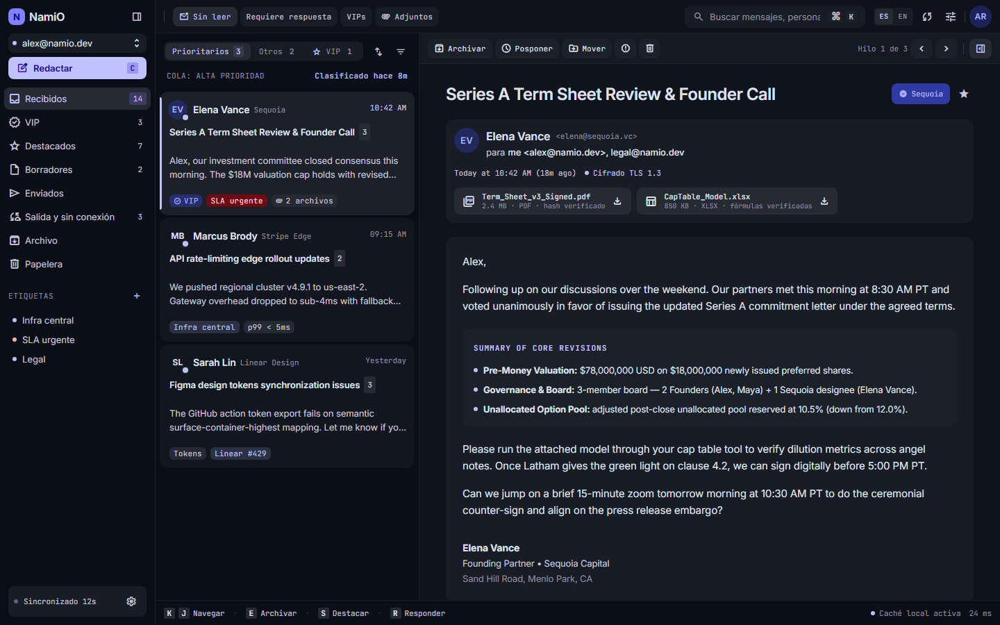

El resto del movimiento es deliberadamente corto: 220 ms al cambiar de pantalla, 160–190 ms al
cambiar de sección o de hilo, y 140 ms de salida en paleta y compositor. Todo respeta
`prefers-reduced-motion`.

| Compositor | Paleta de comandos |
| --- | --- |
| 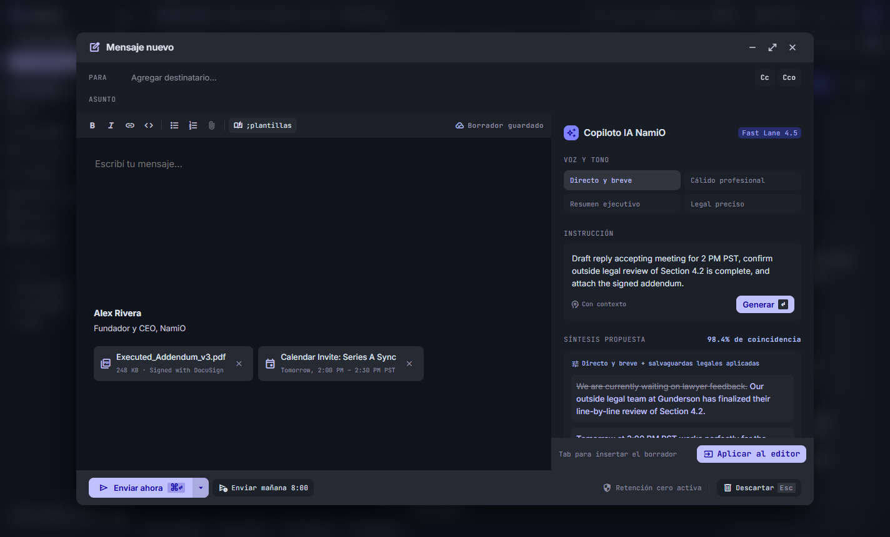 | 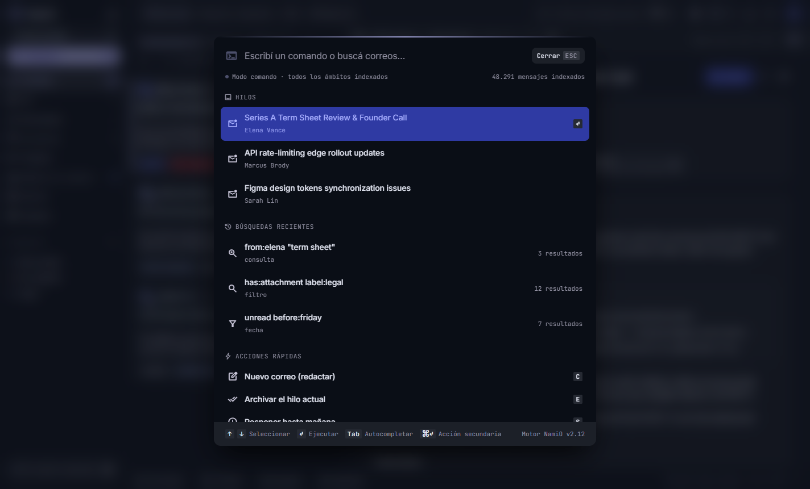 |

Dos decisiones a tener presentes:

- **La UI es bilingüe (es/en)**: toda la copia sale de `src/renderer/src/i18n/`. El contenido de los
  correos no se traduce, se lee en el idioma en que llegó (ver [Idioma](#idioma)).
- **`src/renderer/src/data/demo.ts` es solo la demo**: con una cuenta conectada, los mismos
  componentes leen de la caché SQLite por IPC. La demo queda para "Explorar la demo" del primer
  arranque.

## Idioma

La interfaz está en español e inglés, con un conmutador `ES / EN` en la barra superior.

| Español | English |
| --- | --- |
| 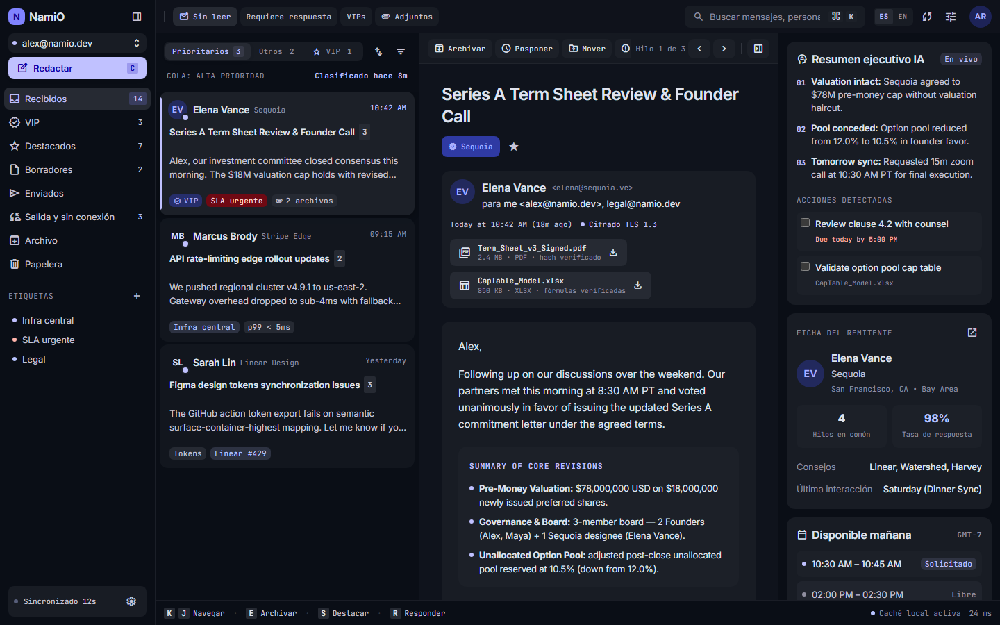 |  |

- Diccionarios tipados en [`src/renderer/src/i18n/`](src/renderer/src/i18n): `es.ts` es la fuente y
  define `Dictionary`; `en.ts` está declarado como `Dictionary`, así que **una clave faltante no
  compila**.
- Idioma inicial: preferencia guardada → idioma del sistema → español.
- La preferencia se persiste en `settings.json` dentro del perfil de la app, por IPC
  (`settings:get` / `settings:set`). El renderer nunca escribe archivos.
- **Se traduce** toda la copia de la interfaz: carpetas, filtros, barra de lectura, paleta de comandos,
  compositor, avisos y etiquetas.
- **No se traduce** el contenido de los correos ni lo derivado de ellos (asuntos, cuerpos, resumen del
  copiloto, acciones detectadas): un correo se lee en el idioma en que llegó.

Sumar un idioma es crear `pt.ts` tipado como `Dictionary` y agregarlo a `LOCALES` y `DICTIONARIES`.

## Configuración y atajos

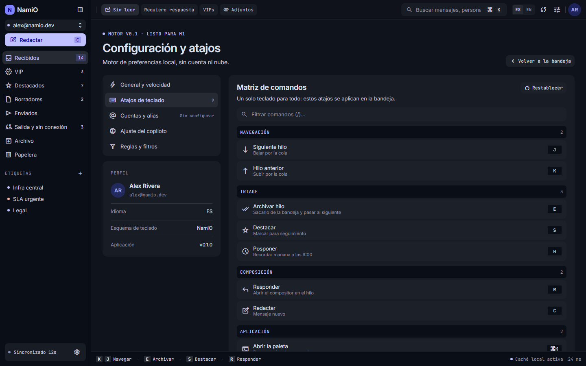

Se abre con `⌘,`, con el engranaje del rail o con el ícono de preferencias. Tiene cinco secciones:
General y velocidad, Atajos de teclado, Cuentas y alias, Ajuste del copiloto, y Reglas y filtros.

- **Atajos remapeables de verdad**: clic en una fila, se presiona la combinación nueva y se aplica.
  Los atajos viven en un provider compartido, así que la bandeja, la leyenda del pie y la paleta
  reaccionan en el acto, y persisten en `settings.json` entre reinicios.
- Detección de conflictos (`⌘K` ya lo usa «Abrir la paleta»), `Esc` reservado para cerrar y botón
  para volver al esquema por defecto.
- Las secciones sin motor todavía (Cuentas, Copiloto, Reglas) son estados vacíos explícitos, no
  maquetas falsas: dicen qué falta y en qué hito llega.
- El diagnóstico muestra versión, Electron y plataforma reales, obtenidos por IPC.

| Acción | Por defecto |
| --- | --- |
| Siguiente / anterior | `J` / `K` |
| Archivar | `E` |
| Destacar | `S` |
| Posponer | `H` |
| Responder | `R` |
| Redactar | `C` |
| Paleta de comandos | `⌘K` |
| Ajustes | `⌘,` |

## M1: IMAP real

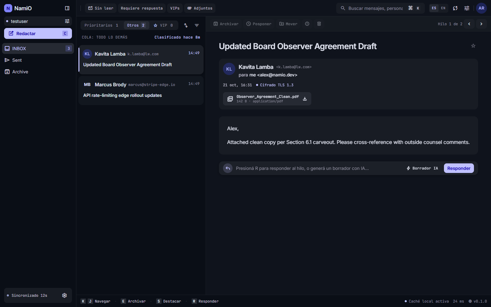

Conectar una cuenta real ya funciona de punta a punta: diálogo de credenciales, buzones del servidor,
bandeja con los últimos 50 mensajes y lectura del cuerpo de texto. El resto del buzón se baja en
segundo plano (ver [Sincronización completa](#sincronización-completa-y-navegación)).

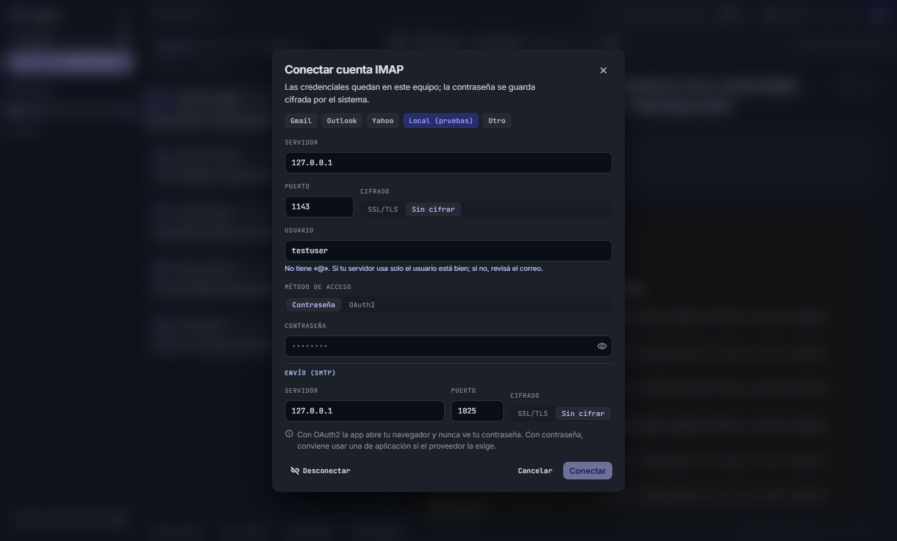

- **Credenciales**: la contraseña se guarda cifrada por el SO con `safeStorage` (DPAPI en Windows,
  libsecret/kwallet en Linux). Si el sistema no ofrece cifrado, no se persiste y el diálogo lo avisa.
- **Transporte**: `imapflow` vive solo en el proceso principal; el renderer no abre sockets. Todo pasa
  por IPC y devuelve `{ ok: true, data }` o `{ ok: false, code, detail }`, con códigos de error
  (auth, dns, refused, timeout, tls, network) que la UI traduce.
- **Buzones**: `LIST` + `STATUS` por buzón (hasta 30) para mostrar totales. Es lento a propósito en M1;
  M3 lo resuelve con la caché local.
- **Mensajes**: `ENVELOPE` + `FLAGS` + tamaño; al abrir, se descarga la fuente y se parsea con
  `mailparser` para mostrar texto y adjuntos. El HTML sanitizado es M2.
- **Destacar** escribe en el servidor (`\Flagged`) desde el primer día. En M1 archivar, mover,
  posponer y eliminar estaban apagados a propósito; archivar y eliminar se habilitaron con la cola de
  salida de M4. **Mover y posponer siguen sin escribir en el servidor.**

Lo que M1 dejó atrás, ya resuelto en hitos siguientes: OAuth2, caché local, HTML y sync incremental.
Sigue sin **STARTTLS** (el cifrado se elige con el switch) y sin `IDLE`.

Para probar sin cuenta real:

```bash
node scripts/fake-imap.mjs 1143   # servidor IMAP en memoria: testuser / testpass
```

En la app: Conectar cuenta → Local (pruebas) → Conectar.

## M2: HTML de correo

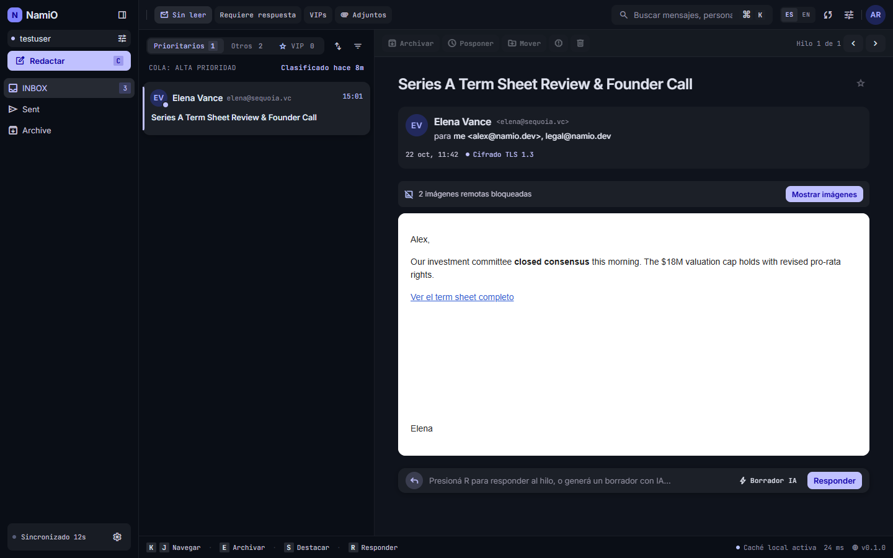

- El HTML se sanitiza con **DOMPurify** y se pinta en un **iframe aislado** (`sandbox="allow-same-origin"`,
  sin `allow-scripts`) con su propia CSP: `default-src 'none'`, imágenes solo `data:` por defecto, sin
  formularios y con `base-uri 'none'`. Aunque la sanitización fallara, no hay scripts posibles.
- **Imágenes remotas bloqueadas por defecto**: se reemplazan por un GIF transparente antes de renderizar,
  así el píxel de tracking nunca se pide. Un banner permite cargarlas solo para ese mensaje, y en
  **Ajustes → General** se elige la política global (`Bloquear` o `Permitir`), que se guarda en el perfil.
- **Links**: los clicks se interceptan y se abren con `shell.openExternal`, que solo acepta `http(s)` y
  `mailto:`. Nada de `javascript:`, `data:` ni `file:`.
- El correo se dibuja sobre **papel claro** por defecto: el HTML ajeno asume fondo blanco. Si preferís
  leer de noche, el **tema del cuerpo** invierte el lienzo (ver [Cuerpo del correo](#cuerpo-del-correo)).
- **Un solo scroll**: el iframe comparte origen (sin scripts), el padre mide su contenido y crece a
  esa altura, sin scroll anidado.

Verificado: 2 imágenes remotas pasan a `data:`, el click de un link no navega el iframe (queda en
`about:srcdoc`, o sea que el `preventDefault` corre) y al mostrar imágenes vuelven las URLs reales.

Limitaciones de M2: sin `cid:` (imágenes embebidas como adjunto) y sin zoom de texto.

## M3: caché local y modo offline

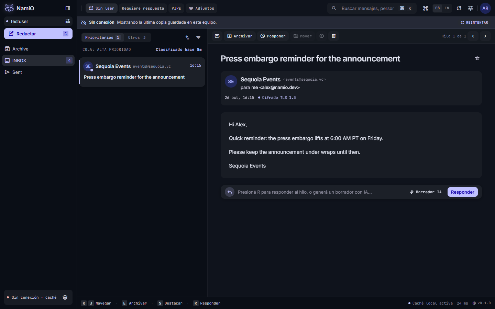

- **SQLite embebido** (`node:sqlite`, sin módulos nativos que recompilar) en `cache.db` dentro del
  perfil. Tablas `mailboxes`, `messages` y `meta`.
- **La UI lee siempre de la caché**; la red solo la actualiza. Al abrir una carpeta con caché se
  responde al instante y se sincroniza en segundo plano; el motor avisa por IPC y la lista se refresca.
- **Sync incremental**: se guardan `UIDVALIDITY` y `UIDNEXT` por buzón. Si cambia la validez de UIDs se
  reinicia ese buzón; si no, se piden solo los mensajes nuevos.
- **Offline real**: si la red falla, la app sigue mostrando la copia local, con una franja
  "Sin conexión", botón de reintento y el estado real en el rail.
- **Caché de cuerpos**: texto, HTML, destinatarios y adjuntos se guardan al leer el mensaje. Si se abre
  uno sin conexión cuyo cuerpo no estaba cacheado, lo dice en vez de inventar.

Limitaciones de M3: sin búsqueda FTS (M5), sin poda de mensajes borrados en el servidor, y archivar /
eliminar siguen deshabilitados porque necesitan la cola de salida de M4.

## M4: envío y cola de salida

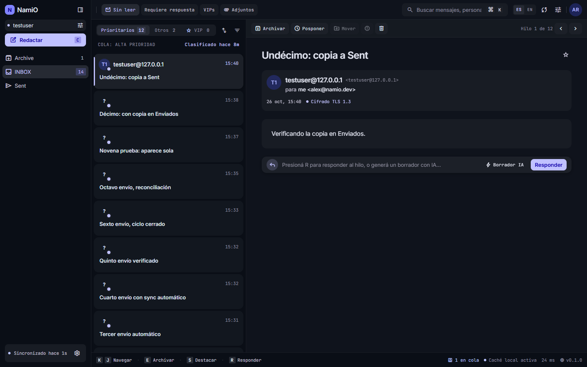

- **SMTP real** con las credenciales de la cuenta (nodemailer), compartiendo usuario y contraseña con
  IMAP; los presets ya cargan también el servidor de envío.
- El mensaje se compone en crudo (RFC 5322, asunto UTF-8) y **lo mismo que sale se copia a Enviados**
  por `APPEND`, así el original queda idéntico.
- **Cola de salida** en SQLite: enviar, archivar y eliminar se encolan primero y se aplican en orden.
  Sin red quedan pendientes (contador en la barra de estado); si el servidor rechaza, se reintenta
  hasta 5 veces y queda `failed` con aviso y botón de reintento.
- **Archivar y eliminar** ya modifican el servidor de verdad y actualizan la caché.
- Después de enviar se sondea la bandeja: si el servidor devuelve la copia (o te escribís a vos mismo),
  aparece sola.

Verificado con el servidor de pruebas: varios envíos llegaron a INBOX y quedaron en Sent, un mensaje
archivado terminó en Archive, otro borrado desapareció del servidor, y un envío encolado sin red salió
al reconectar.

Limitaciones de M4: el cuerpo se envía en **texto plano** (sin HTML) y no se elige remitente
alternativo. Borradores y adjuntos llegaron en el pulido; `IDLE` sigue sin usarse (sondeo cada 60 s).

## M5: búsqueda local (FTS5)

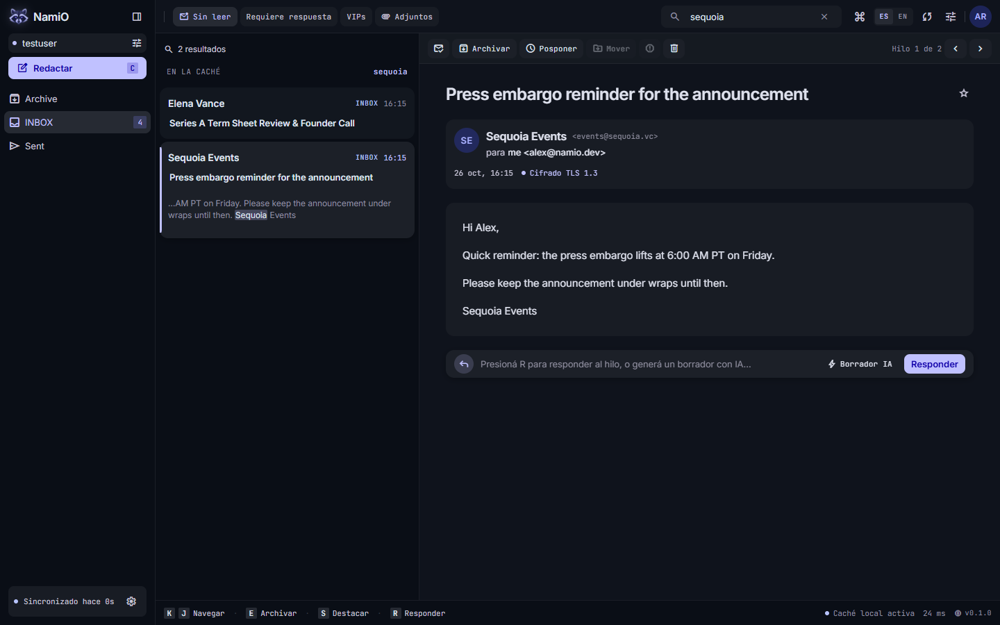

- Índice **FTS5** dentro de la misma base de la caché (`unicode61 remove_diacritics 2`): encuentra
  "valoración" buscando `valoracion`, y funciona con prefijos.
- Se indexan asunto y remitentes de **todos** los mensajes sincronizados, y el **cuerpo** cuando se
  descarga. El índice se mantiene al vuelo (se reindexa al insertar, al actualizar el asunto y al
  guardar el cuerpo).
- Resultados con **fragmento resaltado** (`snippet()` de FTS5), buzón de origen y salto directo al
  mensaje; si vive en otro buzón, la app cambia de carpeta y lo abre.
- La consulta se sanea (comillas, paréntesis, operadores) para que nada de lo que se escriba rompa el
  motor, y va con debounce de 200 ms y mínimo dos caracteres.

Verificado: `sequoia` devuelve 2 mensajes (coincidencia en remitente), `embargo` devuelve 1 con el
fragmento resaltado y `zzzz` no devuelve nada.

Limitación honesta: se busca **solo en la caché**, y los cuerpos entran al índice cuando se abren. La
búsqueda contra el servidor (IMAP `SEARCH`) queda pendiente.

## Pulido para uso diario

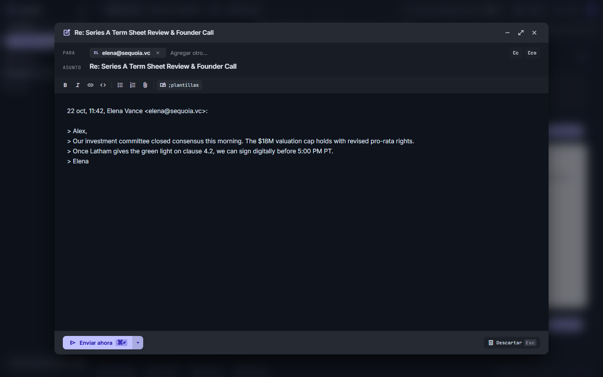

Antes de empaquetar se cerraron los huecos que hacían ruido al usar la app de verdad:

- **Leído / no leído**: abrir un mensaje escribe `\Seen` en el servidor y el cambio se refleja al
  instante; `U` (remapeable) lo alterna y el botón de la barra hace lo mismo. El hilo abierto no
  desaparece del filtro "Sin leer" mientras lo leés: si desapareciera, la selección saltaría al
  siguiente y lo marcaría leído también (una cascada de mensajes leídos sin abrir).
- **Responder con cita**: `R` precarga destinatario, `Re: …` y el cuerpo original citado con `>`.
- **Adjuntos descargables**: cada adjunto se baja del servidor y se guarda con el diálogo del sistema.
- **Flags frescos**: en cada sincronización se refrescan los flags del tramo reciente, así leer desde
  el móvil se ve acá (antes la caché se quedaba con el estado viejo para siempre).
- **Filtros honestos**: en modo real solo se muestran los filtros que tienen datos; el de VIP es de la
  demo y ya no aparece con una cuenta conectada.
- **Compositor limpio**: con cuenta real no aparece el copiloto de demo, ni los adjuntos de ejemplo,
  ni las etiquetas de "guardado automático" y "retención cero" que no eran ciertas.
- **Adjuntos al enviar**: el clip abre el diálogo del sistema y el mensaje sale como `multipart/mixed`
  (compilado con nodemailer); la copia en Enviados es exactamente el mismo crudo que se envió.
- **Borradores IMAP**: cerrar el compositor guarda un borrador independiente por cuenta y encola su
  sincronización con la carpeta `\Drafts`. Se editan desde la lista de esa carpeta, incluidos los
  pendientes locales. Conservan formato, CC/CCO y adjuntos; guardar otra revisión reemplaza solo su
  copia anterior. Los reintentos buscan el Message-ID antes de volver a subirla.
- **Enviar o descartar**: elimina la copia del servidor mediante la cola; un envío pendiente conserva
  su borrador hasta que SMTP confirme el mensaje. Enviar una versión antigua no borra ediciones nuevas.
- **Mensaje nuevo**: siempre comienza vacío. «Recuperar borrador» abre explícitamente el último local.

Limitaciones conocidas: la sincronización requiere que esa cuenta esté activa y una carpeta de
borradores del servidor. Las actualizaciones y eliminaciones usan `UIDPLUS` y comprueban `UIDVALIDITY`
para no borrar otros mensajes. El envío no permite aún elegir remitente alternativo.

## Reglas locales (M7)

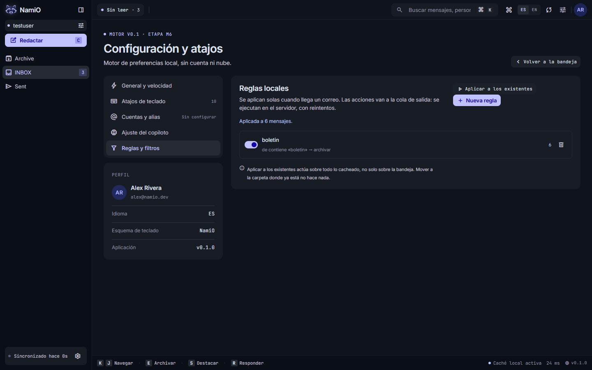

En **Ajustes → Reglas y filtros** se define qué pasa solo cuando llega correo.

- **Cuándo actúan**: por su cuenta con los mensajes **nuevos** (los que aparecen por primera vez en
  la caché; el relleno histórico de la sync completa no las dispara, para no archivar años de correo
  de golpe) y, a pedido, con **Aplicar a los existentes** sobre todo lo cacheado.
- **Cómo deciden**: la **primera regla habilitada que coincide gana**, así un mensaje no recibe dos
  acciones contradictorias. Campos: De, Asunto, Para o cualquiera; condiciones: contiene, empieza con
  o es igual a; la comparación ignora mayúsculas y acentos (`Boletín` encuentra `boletin`).
- **Qué hacen**: archivar, mover a un buzón, marcar leído o eliminar. Todas pasan por la **cola de
  salida**, o sea que se ejecutan en el servidor y se reintentan si fallan. Mover a la carpeta donde
  el mensaje ya está no hace nada.
- **Contadores honestos**: cuando una regla saca un mensaje no leído, el badge de la carpeta baja en
  el acto (no espera al sondeo de un minuto). Cada regla acumula sus `hits`.

Verificado con un buzón de 11 mensajes y la regla *de contiene «boletin» → archivar*: aplicada a los
existentes movió **6**, en el servidor INBOX quedó en 5 y Archive en 6, la regla marcó `hits = 6`,
la cola de salida quedó vacía y el badge de no leídos bajó de 9 a 3 sin recargar.

## Varias cuentas (M8)

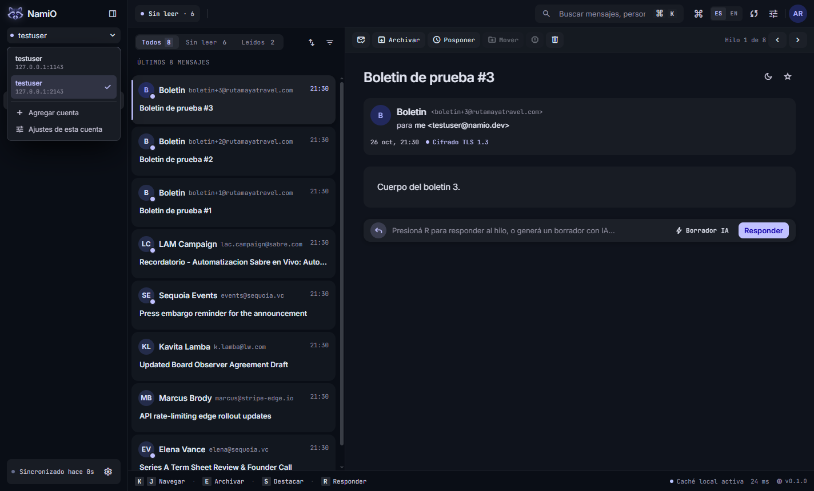

El rail permite tener **varias cuentas guardadas** y cambiar entre ellas sin reiniciar.

- **Cómo se agrega**: menú de la cuenta → *Agregar cuenta* (el mismo diálogo, con IMAP, SMTP y OAuth2).
  Conectar una cuenta nueva la deja activa.
- **Cómo se cambia**: se elige del menú; cada entrada muestra usuario, `host:puerto` y una marca en la
  activa. Al cambiar se corta la sesión, se reapunta la caché y la bandeja se relee sola.
- **Una caché por cuenta** (`cache-<id>.db`, y `cache.db` para la primera): carpetas, mensajes,
  búsqueda, cola de salida y **reglas** quedan separadas sin cambiar el esquema. Eso también evita el
  bug clásico de enviar con las credenciales de la cuenta equivocada, porque la cola vive en la caché
  de su cuenta.
- **Una conexión a la vez**: al cambiar de cuenta se cierra la sesión anterior. No hay bandeja
  unificada todavía.

Verificado con dos servidores de prueba (1143 con 11 mensajes, 2143 con 8): conectar el primero dejó
la caché `cache.db`; agregar el segundo creó `cache-acc-2-testuser.db` y lo dejó activo; desde el menú
se volvió al primero y la lista mostró sus **11** hilos (el segundo conserva los **8**). Las reglas y
la cola no se mezclan porque cada cuenta tiene su base.

### Avisos de la cuenta inactiva

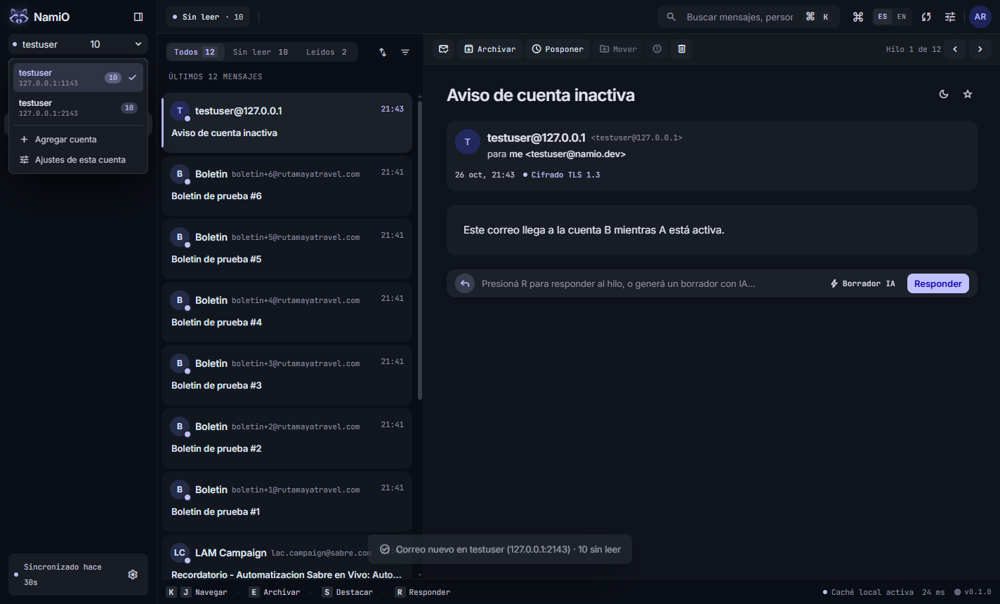

Con varias cuentas, la que no está activa también avisa:

- Cada **3 minutos** (y al abrir el menú de cuentas, o después de conectar/cambiar) el proceso
  principal abre una **sesión corta** por cuenta inactiva y pide solo `STATUS INBOX`: no descarga
  mensajes ni deja otra conexión abierta.
- Si los no leídos **suben**, aparece un aviso con la cuenta identificada por `host:puerto` (dos
  cuentas pueden ser del mismo usuario) y el total; el menú muestra el contador de cada cuenta y el
  pill del rail un badge con la suma de las inactivas.
- Solo avisa cuando **sube**: ni al bajar, ni la primera vez que se ve una cuenta.

Verificado con dos servidores: con A activa y B inactiva, un mensaje nuevo en B pasó el contador de
**6 → 7** y el aviso dijo *Correo nuevo en testuser (127.0.0.1:2143) · 7 sin leer*; el badge del rail y
el menú coincidieron. Repetido con 9 y 10: el aviso vuelve a aparecer solo cuando entra correo.

## Integridad del CSS

`pnpm run css:audit` cruza el CSS con el JSX y verifica cuatro cosas: que toda variable usada esté
definida, que toda clase usada en un componente tenga al menos una regla, que los `url()` locales
resuelvan y que el bundle construido conserve sus assets (fuentes incluidas).

Estado actual: **382 clases definidas / 367 usadas · 54 variables (46 usadas) · bundle 87.0 kB ·
0 problemas**.

Lo que encontró y se corrigió en esta pasada:

- `--tertiary-container` se usaba en dos lugares y **nunca se definía**, así que `.avatar--tertiary`
  se quedaba sin fondo (la declaración entera era inválida). Ahora está en `tokens.css`.
- `.mono` se usaba en Ajustes para versiones y rutas, **sin regla**: los valores salían en la fuente
  de interfaz. Se agregó la utilidad.
- `.list-empty` (estado vacío de búsqueda), `.attachment__icon` y `.statusbar__version` se usaban sin
  estilo propio; se agregaron sus reglas.
- `var(--text-dim, …)` apuntaba a una variable inexistente; se dejó el fallback directo.

Deuda anotada, sin efecto en runtime: 8 variables y 15 clases que vienen de los mockups y ya no se
usan (`t-headline-*`, `kbd--*` extra, `btn--surface/quiet/ghost`, etc.). Se pueden podar cuando
convenga; el auditor las lista con `--verbose`.

## OAuth2 (Gmail y Outlook)

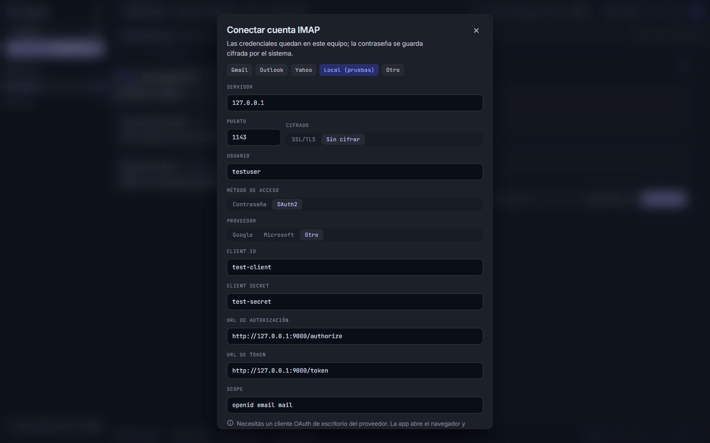

Gmail y Microsoft ya no aceptan usuario + contraseña para IMAP/SMTP. La app implementa el flujo de
escritorio completo, sin backend:

- **PKCE (S256)** y redirect a un **loopback efímero** (`http://127.0.0.1:<puerto libre>/callback`),
  con `state` verificado; para Microsoft usa `localhost`, que es lo que exige su registro.
- **El refresh token se guarda cifrado** con `safeStorage` (DPAPI, libsecret o Keychain); el access
  token vive en memoria y se renueva solo. Al reabrir la app se reconecta sin tocar el navegador.
- **IMAP por XOAUTH2** (`imapflow`) y **SMTP por XOAUTH2** (`nodemailer`) con el mismo token.
- En el diálogo, con Gmail u Outlook el método **Contraseña queda deshabilitado** y se explica por qué:
  Google y Microsoft cerraron la autenticación básica para IMAP (las contraseñas de aplicación
  incluidas). Elegir el preset ya deja OAuth2 seleccionado, así no hay un camino que sepamos que falla.
- Necesitás **tu propio cliente OAuth de escritorio**; no se puede embeber uno en el binario:
  - Google Cloud → *Credentials* → *OAuth client ID* → **Desktop app**.
  - Microsoft Entra → *App registrations* → plataforma **Mobile and desktop** → redirect
    `http://localhost`.
- Presets incluidos: Google (`https://mail.google.com/`), Microsoft (`IMAP.AccessAsUser.All` +
  `SMTP.Send`) y **Otro** para cualquier proveedor con endpoints propios.

Verificado contra un proveedor falso (`scripts/fake-oauth.mjs`): el `code_challenge` viaja, el código
se canjea con el `code_verifier`, el access token entra al IMAP de pruebas por XOAUTH2, el refresh
funciona sin navegador al reiniciar y el envío SMTP sale autenticado con el mismo token.
**Microsoft no se probó contra un tenant real.**

## Primer arranque

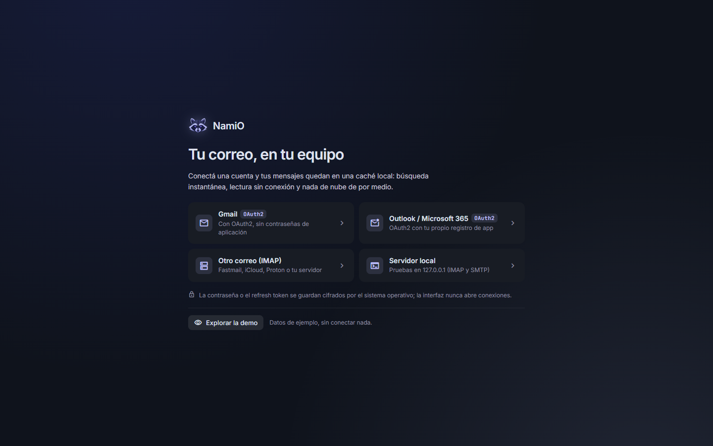

Un perfil vacío ya no cae directo en la demo: abre una bienvenida con el camino corto.

Al abrir, la app pasa por una **pantalla de carga** (logo, barra fina y "Abriendo tu correo…") hasta
que sabe si hay cuenta configurada y si ya pasaste por la bienvenida. Sin ese corte se veía la
bandeja de demo y un instante después la bienvenida encima; medido con CDP: el loader aparece a
~100 ms y en ese momento no hay ni bandeja ni onboarding pintados.

1. **Elegir proveedor** — Gmail y Outlook / Microsoft 365 (OAuth2), otro correo IMAP (Fastmail,
   iCloud, Proton, tu servidor) o servidor local para pruebas.
2. **Conectar** — la bienvenida tiene su **propio formulario**, adaptado al proveedor: Gmail/Outlook
   piden correo + Client ID (OAuth2, hosts fijos); otro IMAP pide correo, contraseña y servidor de
   salida; local viene precargado con `127.0.0.1`.
3. **Usar el correo** — al conectar se cargan buzones y bandeja; la bienvenida no vuelve a aparecer.

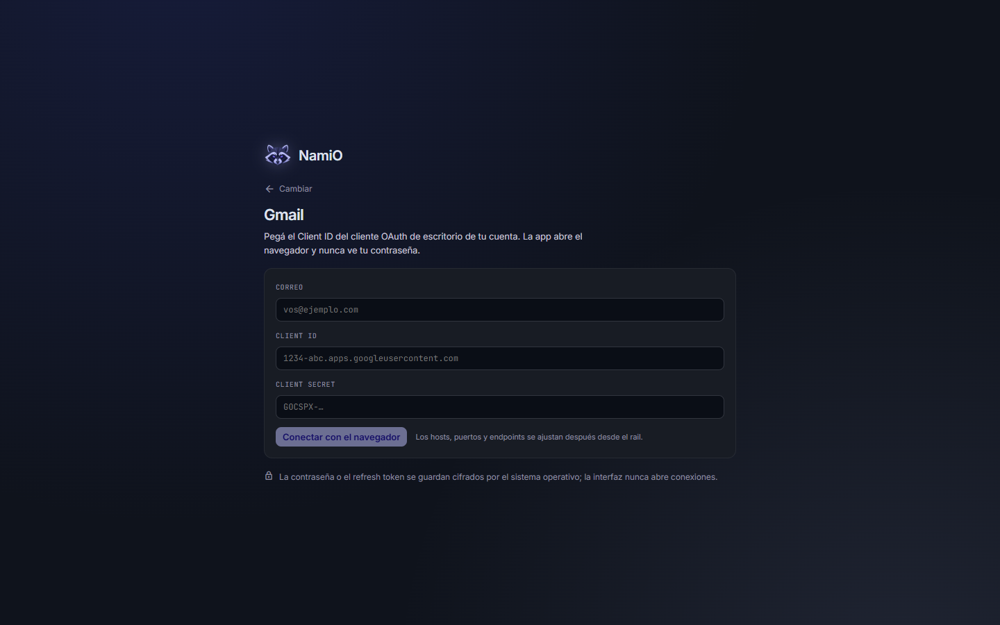

El diálogo de cuenta del rail queda para **después**: ajustar hosts, puertos, endpoints OAuth o
cambiar de método. El alta no pasa por ahí.

"Explorar la demo" sigue a un click y la decisión se guarda en `settings.json` (`onboarded`), así que
no vuelve a preguntar. Quien ya tiene cuenta configurada nunca ve la bienvenida.

Verificado: Gmail muestra el formulario OAuth2 en la propia bienvenida (sin abrir el diálogo); "Cambiar"
vuelve a la grilla de proveedores; "Servidor local" precarga `127.0.0.1:1143` y conecta con la cuenta
de pruebas, que carga `Archive/INBOX/Sent`; y sin servidor, el error aparece **inline**
("El servidor rechazó la conexión") en vez de un banner global.

## Sincronización completa y navegación

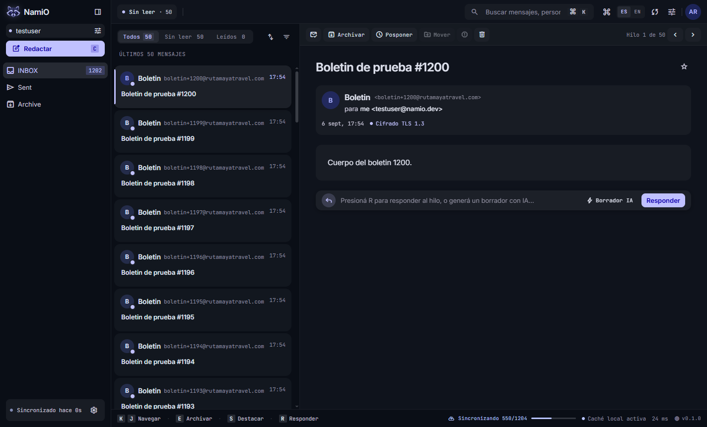

- **El contador de cada carpeta es de no leídos** (como en cualquier cliente): INBOX mostraba el
  total (2088) y ahora muestra los que esperan respuesta.
- **La lista tiene barra de scroll visible** (el resto de la app la oculta a propósito) y **crece de
  a 100** al llegar al final, hasta 2000: como la caché ya tiene todo, es instantáneo. Al pedir otra
  tanda se conserva el cuerpo del mensaje abierto, así el lector no parpadea.
- **Sync completa en segundo plano**: el primer sync baja los últimos 50 y, si el servidor tiene más,
  sigue tramo a tramo de 100 (con una pausa corta entre tramos para no trabar la lectura) hasta
  cubrir el buzón. El progreso va en el pie: `Sincronizando 550/1204` con barra.
- Se reanuda sola al abrir la app o al reabrir la carpeta si quedó incompleta, y nunca corre dos
  veces en paralelo.

Verificado con un buzón de **1204 mensajes**: la caché terminó con los 1204, el badge mostró **1202**
(no leídos reales), la barra pasó por 71 % → 96 % y desapareció al terminar, y el scroll agregó
filas (50 → 150). El fixture acepta volumen: `node scripts/fake-imap.mjs 1143 1025 1200`.

## Cuerpo del correo

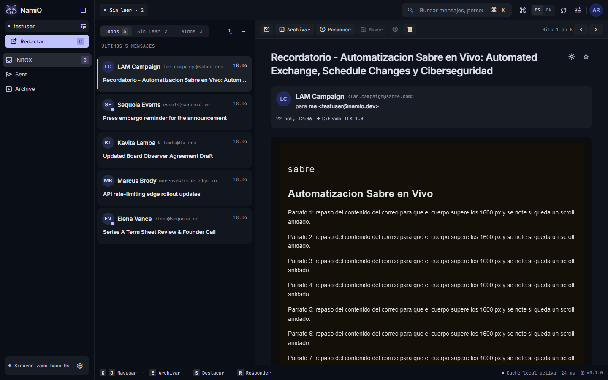

- **Tema del cuerpo (claro/oscuro)**: el HTML de los correos trae sus propios colores, así que en
  oscuro se invierte el lienzo (con las imágenes re-invertidas para que no queden en negativo). Se
  cambia desde el lector (icono sol/luna al lado de la estrella) o desde Ajustes → *Tema del cuerpo*,
  y queda guardado.
- **Un solo scroll**: el iframe del correo mide la altura real de su contenido y crece a ella. Antes
  estaba limitado a 1600 px, y un correo más alto quedaba con scroll propio adentro. La altura se
  re-mide con un `ResizeObserver`, así también se ajusta cuando cargan las imágenes.
- **La estrella ya no se cae**: con asuntos de dos líneas, el encabezado se envolvía y el botón
  bajaba debajo del título. Ahora el título ocupa el espacio disponible y la estrella queda siempre
  arriba a la derecha.

Verificado: asunto de 64 px de alto (dos líneas) con estrella y título en la misma `y`; cuerpo de
3650 px con `contenido == ventana` y **0 px de scroll interno**; al alternar el tema el filtro pasa a
`invert(1) hue-rotate(180deg)` con fondo `#14161b` y `settings.json` guarda `bodyTheme`.

## Cómo probarlo

Tres caminos, de más rápido a más real:

1. **Sin instalar** (si tenés Node 22+ y pnpm 12): `pnpm install && pnpm dev`. La app abre con un
   perfil de desarrollo en `.cache/userdata` y el servidor de pruebas se levanta aparte con
   `node scripts/fake-imap.mjs 1143` (usuario `testuser`, contraseña `testpass`).
2. **Instalable**: bajá `NamiO-0.2.0.AppImage` o `namio_0.2.0_amd64.deb` de
   [Releases](https://github.com/PinedaMB/NamiO/releases) y ejecutalo.
3. **Con tu cuenta real**: Gmail/Outlook necesitan tu propio cliente OAuth (ver
   [OAuth2](#oauth2-gmail-y-outlook)); cualquier otro IMAP va con contraseña o contraseña de
   aplicación.

Qué vale la pena recorrer en esta versión:

| Probá | Qué debería pasar |
| --- | --- |
| Primer arranque | Bienvenida → elegir proveedor → conectar → bandeja |
| Reglas (Ajustes → Reglas y filtros) | Crear regla, aplicar a los existentes, ver los `hits` |
| Multi-cuenta | Agregar una segunda cuenta y cambiar desde el menú del rail |
| Cuenta inactiva | Con otra cuenta activa, el rail muestra el badge y avisa al llegar correo |
| Correo HTML | Imágenes bloqueadas con aviso, un solo scroll, botón de tema claro/oscuro |
| Sincronización | Barra de progreso en el pie mientras baja el buzón completo |
| Desconexión | Cortar la red: la app sigue mostrando la caché con la franja "Sin conexión" |

Los datos viven en el perfil (Linux: `~/.config/NamiO`). Para empezar de cero, cerrá la app y borrá
esa carpeta. Un `cache-<id>.db` por cuenta y `settings.json` con cuentas, idioma y preferencias.

## Comandos

```bash
pnpm install
pnpm dev            # app en desarrollo con HMR; detecta solo si puede usar el sandbox
pnpm dev:raw        # electron-vite dev crudo (sin detección)
pnpm dev:web        # solo el renderer (Vite + HMR), sin Electron
pnpm dev:restricted # fuerza sandbox desactivado (ver más abajo)
pnpm typecheck      # tsc para main/preload y para el renderer
pnpm build          # typecheck + build de producción en out/
pnpm build:linux    # AppImage + .deb (requiere Linux o CI)
pnpm pack:dir       # linux-unpacked para inspeccionar el paquete
pnpm pack:inspect   # resumen del app.asar: deps, fuentes y entrypoints
pnpm css:audit      # integridad del CSS contra el JSX
pnpm preview        # sirve out/renderer en http://127.0.0.1:4173 (revisar UI sin Electron)
node scripts/fake-imap.mjs   # IMAP 1143 + SMTP 1025, con XOAUTH2 (testuser/testpass | testtoken)
node scripts/fake-oauth.mjs  # proveedor OAuth2 falso en 9000 (para probar el flujo)
```

Herramientas de revisión visual (usan Edge o Chromium headless, no Electron):

```bash
node scripts/shoot.mjs http://127.0.0.1:4173/ .cache/inbox.png   # captura PNG
node scripts/shoot.mjs http://127.0.0.1:4173/ .cache/x.png "document.querySelector('.search').click()"
node scripts/probe.mjs "document.querySelector('.statusbar').getBoundingClientRect().width"
```

Los artefactos quedan en `release/`.

## Empaquetado

### Qué se puede construir desde Windows

| Comando | Resultado | Sirve para |
| --- | --- | --- |
| `pnpm build` | `out/` (main, preload, renderer) | desarrollo y empaquetado |
| `pnpm run pack:dir` | `release/linux-unpacked` | validar el contenido del paquete |
| `pnpm run pack:inspect` | resumen del asar | comprobar deps, fuentes y entrypoints |
| `pnpm exec electron-builder --win dir` | `release/win-unpacked` | probar el wrapper en Windows |

El paquete de Linux quedó verificado así: `app.asar` de **12.68 MB / 856 archivos** con las
dependencias de runtime (`imapflow`, `mailparser`, `nodemailer` y sus transitivas), **13 fuentes
woff2 (4.1 MB)** incluidas las de Material Symbols, y `out/main`, `out/preload` y `out/renderer`
completos. Se comprueba con `pnpm run pack:inspect`.

Y sobre ese mismo `app.asar`, ejecutado como aplicación:

- Inter Variable, JetBrains Mono y Material Symbols **cargan desde el asar** (`document.fonts.check`).
- La **CSP se aplica de verdad**: un `<script>` inline inyectado **no se ejecuta**.
- **Perfil nuevo → bienvenida**; "Explorar la demo" entra a la bandeja (3 hilos) con el botón de
  tema del cuerpo presente.
- Cero errores de consola y cero excepciones.

Y sobre el ejecutable empaquetado de Windows (construido solo para probar el wrapper), con
`isPackaged: true`: la CSP sigue aplicándose (script inline bloqueado), las fuentes cargan del asar,
el perfil nuevo muestra la bienvenida y no hay errores de consola. **Necesita el sandbox desactivado
en este entorno**, exactamente como `pnpm dev` (ver más abajo): sin eso Chromium muere con
`STATUS_BREAKPOINT` antes de mostrar la ventana.

### Por qué AppImage y .deb necesitan Linux

- **AppImage** arma el layout con symlinks; Windows devuelve `EPERM` sin modo desarrollador o
  privilegios de administrador.
- **deb** usa `fpm`, que no existe en Windows.

En Linux (o en CI, que es lo recomendado):

```bash
pnpm install
pnpm run build:linux     # → release/NamiO-0.2.0.AppImage + release/namio_0.2.0_amd64.deb
```

La CI está en dos workflows, y se reparten el trabajo para no empaquetar de más:

| Workflow | Cuándo | Qué hace |
| --- | --- | --- |
| [`ci-linux.yml`](.github/workflows/ci-linux.yml) | push a `main`/`master` y PRs | instala, audita el CSS y compila (`pnpm build` incluye typecheck) |
| [`release-linux.yml`](.github/workflows/release-linux.yml) | tag `v*` o a mano | lo anterior + `electron-builder --linux` y publica `.AppImage` y `.deb` |

En un tag, además del artefacto del run, la Release de GitHub queda con los instalables adjuntos
(`softprops/action-gh-release`), así se descargan sin pasar por Actions.

Para disparar un release, con el remoto ya configurado:

```bash
git remote add origin <url-del-repo>
git push -u origin master
git push origin v0.2.0     # tag anotado: dispara release-linux.yml
```

El tag tiene que apuntar al commit que querés publicar (`git describe --tags` lo confirma).

### Los releases

| Versión | Qué trae |
| --- | --- |
| [v0.2.1](https://github.com/PinedaMB/NamiO/releases/tag/v0.2.1) | Corrección: icono del error y Outlook sin contraseña |
| [v0.2.0](https://github.com/PinedaMB/NamiO/releases/tag/v0.2.0) | Reglas locales, varias cuentas y avisos de la cuenta inactiva |
| [v0.1.0](https://github.com/PinedaMB/NamiO/releases/tag/v0.1.0) | Primera entrega: cuenta, OAuth2, bienvenida, sync completa y reglas no |

El primer release (v0.1.0) salió del workflow `release-linux` en **2 min 15 s** y trajo
`NamiO-0.1.0.AppImage` (126.3 MB) y `namio_0.1.0_amd64.deb` (101.8 MB). El `.deb` se verificó
abriéndolo (sin `dpkg`): `control` dice `Package: namio`, `Maintainer: PinedaMB
<mendez-pineda@outlook.es>`, `Homepage: https://github.com/PinedaMB/NamiO` y `Depends` con
GTK3/NSS/libsecret; instala **91 archivos**, con el icono de 512², el `.desktop` y el binario en
`/opt/NamiO/namio`.

Dos cosas que costaron el primer intento:

- **No declares `version` en `pnpm/action-setup` si `package.json` ya tiene `packageManager`**: el
  action aborta con *Multiple versions of pnpm specified*. Se declara en un solo lugar.
- **Los assets de una Release privada no se bajan por `browser_download_url`** con un token de
  acciones: hay que pedirlos por la API (`/releases/assets/{id}` con `Accept: application/octet-stream`).

### Marca y asociación de ventana

- `build/icon.png` (512×512) y `build/icon-1024.png`: el **mapache índigo** de la app, con fondo
  transparente y 4 % de respiro. Se regeneran desde `build/logo-source.png` con
  `python scripts/make-icons.py` (recorta el alfa del master y exporta 1024/512/256).
- `src/renderer/src/assets/logo.png` (256²) es la marca dentro de la interfaz: el rail la muestra a
  30 px junto al wordmark.
- `desktopName: namio.desktop` en `package.json` + `linux.syncDesktopName` en `electron-builder.yml`
  para que GNOME/KDE asocien la ventana con el lanzador.
- Metadatos listos: `author`/`maintainer` `PinedaMB <mendez-pineda@outlook.es>`, y `homepage` +
  `repository` apuntando a [github.com/PinedaMB/NamiO](https://github.com/PinedaMB/NamiO).
### La CSP en producción va por meta, no por cabecera

La app empaquetada carga `file://`, donde no existen cabeceras de respuesta: una CSP puesta con
`onHeadersReceived` **no se aplica**. Por eso la política viaja como `<meta http-equiv>` inyectado
solo en build (`electron.vite.config.ts`); en desarrollo la relaja Vite para el HMR.

## Estado de verificación

| Comprobación | Estado |
| --- | --- |
| `pnpm install` reproducible (pnpm 12, builds autorizados) | ✅ |
| `pnpm typecheck` (main/preload y renderer) | ✅ |
| `pnpm build` → `out/main`, `out/preload`, `out/renderer` | ✅ |
| App Electron real: ventana, IPC y smoke test 7/7 | ✅ |
| UI capturada en Chromium headless (bandeja, compositor, paleta) | ✅ |
| Remapeo de atajos: aplicado en vivo y persistido en `settings.json` | ✅ |
| M1: cuenta IMAP, buzones, bandeja, cuerpo y adjuntos (contra servidor de prueba) | ✅ |
| Destacar (`\Flagged`) escrito en el servidor | ✅ |
| M2: HTML sanitizado en iframe, imágenes bloqueadas y links externos | ✅ |
| M3: caché SQLite, sync incremental y modo offline | ✅ |
| Reapertura con el servidor caído mostrando la caché | ✅ |
| M4: envío SMTP, copia en Enviados, cola con reintentos | ✅ |
| Archivar y eliminar aplicados en el servidor | ✅ |
| M5: búsqueda FTS5 sobre la caché con fragmentos | ✅ |
| Leído/no leído, responder con cita y adjuntos descargables | ✅ |
| Adjuntos al enviar (multipart) y borrador persistido | ✅ |
| OAuth2 (PKCE + loopback) con XOAUTH2 en IMAP y SMTP | ✅ |
| Bienvenida guiada: proveedor → conexión → bandeja | ✅ |
| Ojo para ver la contraseña y detalle del rechazo del servidor | ✅ |
| Sync completa en segundo plano con progreso, badge de no leídos y scroll | ✅ |
| Tema del cuerpo del correo, un solo scroll y estrella alineada | ✅ |
| Reglas locales: alta, activar/desactivar, aplicar a la caché y `hits` | ✅ |
| Varias cuentas conmutables con caché separada por cuenta | ✅ |
| Aviso de correo nuevo en la cuenta inactiva (STATUS por cuenta) | ✅ |
| Paquete Linux (`linux-unpacked`) inspeccionado y ejecutado desde su asar | ✅ |
| App empaquetada (`isPackaged: true`): CSP, fuentes del asar, bienvenida y cero errores | ✅ |
| AppImage + `.deb` publicados por CI en cada tag ([v0.2.0](https://github.com/PinedaMB/NamiO/releases/tag/v0.2.0)) | ✅ |

### Si `pnpm dev` muere con `-2147483645` o `0xc0000005`

No es el proyecto: es Chromium inicializando en un entorno restringido. Hay dos causas
independientes, y conviene distinguirlas porque los códigos se parecen:

1. **Sandbox de Chromium.** Dentro de un Job Object restrictivo (contenedores, CI, terminales
   embebidas) Chromium no puede crear su sandbox y llama a `__debugbreak()`: el proceso muere con
   `STATUS_BREAKPOINT` (`0x80000003`, que Node reporta como `-2147483645`) antes de ejecutar una sola
   línea de JavaScript.
2. **Perfil no escribible.** Si `%APPDATA%` está bloqueado por un sandbox de archivos, Chromium muere
   con `ACCESS_VIOLATION` (`0xc0000005`) mientras inicializa su perfil, sin ningún mensaje de error.

`scripts/dev.mjs` resuelve las dos antes de arrancar: sonda `electron --version` (no necesita perfil
ni ventana, y falla exactamente cuando el sandbox no puede crearse) y mueve el perfil a
`.cache/userdata`, que siempre es escribible dentro del proyecto.

```bash
pnpm dev              # detecta y se adapta; no hace falta que elijas nada
pnpm dev:restricted   # fuerza sandbox desactivado (si la sonda te da un falso positivo)
pnpm dev:raw          # electron-vite dev crudo, para diagnosticar
```

| Situación | Resultado de `pnpm dev` |
| --- | --- |
| Terminal normal de Windows/Linux | sandbox activo, perfil en `.cache/userdata` |
| Contenedor, CI o terminal embebida | sandbox desactivado **solo en desarrollo** + aviso en consola |
| Solo la UI, sin Electron | `pnpm dev:web` → http://localhost:5173 |

Nunca se desactiva el sandbox en los builds de producción: eso vive únicamente en el lanzador de
desarrollo. El perfil de desarrollo se resetea borrando `.cache/userdata`.

Smoke test automático (necesita la app con `--remote-debugging-port=9333`):

```bash
node scripts/smoke.mjs
```

Valida que React montó, que el puente IPC existe, que `window.require` **no** está expuesto y que el
núcleo responde con un `stage` válido (M0–M8).

## Roadmap

| # | Entrega | Criterio de listo |
| --- | --- | --- |
| ✅ M0 | Esqueleto, aislamiento y contrato IPC | La app abre y reporta estado del núcleo |
| ✅ Shell | Identidad visual de NamiO sobre datos de demostración | Bandeja, compositor y paleta navegables |
| ✅ M1 | **Rebanada vertical**: conectar 1 cuenta IMAP, listar carpetas, abrir INBOX | Se ven correos reales en pantalla |
| ✅ M2 | Visor de mensaje: MIME, HTML sanitizado, adjuntos | Se abre un correo con imágenes y links |
| ✅ M3 | Caché SQLite + sync incremental + offline | Sin red, la app muestra todo lo ya sincronizado |
| ✅ M4 | Envío SMTP + cola de salida + archivar/eliminar | Me envío un correo y me llega |
| ✅ M5 | Búsqueda FTS5 sobre la caché | Encuentro un correo por una palabra del cuerpo |
| ✅ M6 | OAuth2 (Gmail/Outlook) + empaquetado en CI | Instalable en Linux vía `.deb` |
| ✅ M7 | Reglas locales: archivar, mover, marcar leído o eliminar al llegar | Un remitente molesto se archiva solo |
| ✅ M8 | Multi-cuenta conmutables, con caché y cola por cuenta | Dos cuentas a la vez, cada una con su bandeja |

## Los problemas que hay que respetar desde el día uno

1. **OAuth2 no es un extra.** Gmail y Outlook dejaron de aceptar contraseña de aplicación en muchos
   casos: si el cliente no trae PKCE con redirect a loopback, media base de usuarios no puede entrar.
   (Se implementó en M6; costó hacerlo tarde.)
2. **Sync incremental de verdad.** `UIDVALIDITY` y `UIDNEXT` son el mínimo; `CONDSTORE`/`QRESYNC`
   evita re-bajar la bandeja entera cada vez.
3. **MIME real.** Multipart anidado, `encoded-words` (RFC 2047), charsets rotos, base64 y
   quoted-printable, adjuntos en streaming (nunca cargar 30 MB en memoria).
4. **HTML hostil.** Sanitizar (DOMPurify), bloquear imágenes remotas por defecto (tracking pixels),
   cero JS y CSP estricta. El único iframe permitido es el del correo, con `sandbox` sin
   `allow-scripts` y su propia CSP.
5. **Gmail no es IMAP estándar.** Etiquetas vs. carpetas, `[Gmail]/All Mail`, nombres en UTF-7.
6. **Cola de salida idempotente.** Sin red el envío se encola; con red se reintenta sin duplicar.

## Notas de despliegue en Linux

- Los paquetes se generan en
  [`.github/workflows/release-linux.yml`](.github/workflows/release-linux.yml) (Ubuntu), no desde Windows.
- El icono ya está: `build/icon.png` (512²) y `build/icon-1024.png`, ambos desde `build/logo-source.png`.
- Autor y maintainer ya son **PinedaMB <mendez-pineda@outlook.es>** (el `.deb` usa el maintainer).
- `homepage` y `repository` apuntan a <https://github.com/PinedaMB/NamiO>.
- Flatpak queda para después; el canal natural es Flathub con el runtime de Electron.
